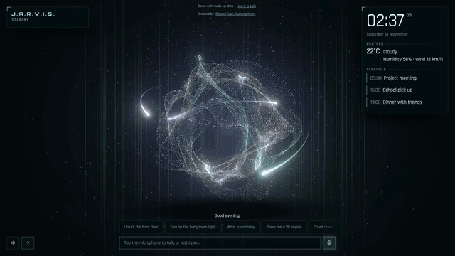
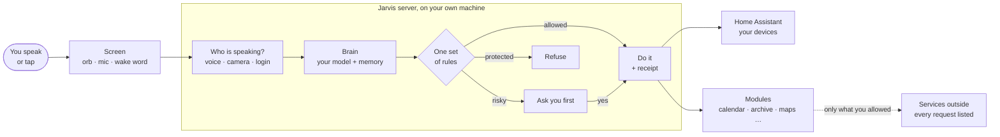
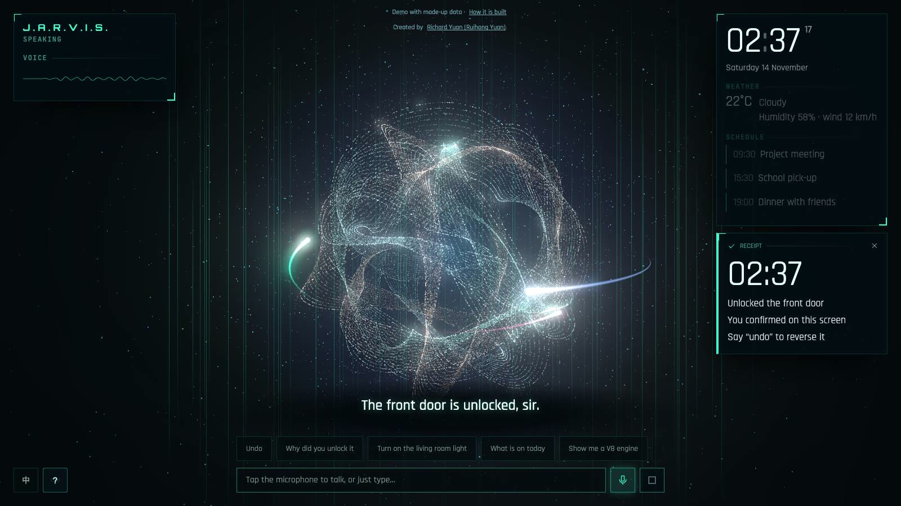
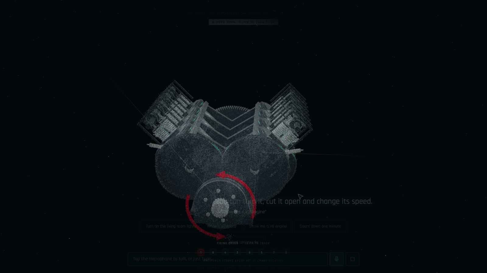

# J.A.R.V.I.S.

English | [中文](README.zh.md)

A household voice butler on your own server, where risky actions are checked by code, not left to the model. It knows the people it works for, acts for them within the limits they set, and can show you everything it did and why.

By **Richard Yuan (Ruihong Yuan)** · tardisyuan@gmail.com · **[Try the live demo →](https://jarvis-demo.tardisyuan.ltd/?lang=en)** · [How it is built](https://jarvis-demo.tardisyuan.ltd/how)

**Hiring?** Start with [What was hard](#what-was-hard), then [How it was built](#how-it-was-built) and the [design notes](#design-notes). Questions or a role to talk about: email, or [open an issue](https://github.com/Tardisyuan/jarvis-showcase/issues/new/choose). **Into Home Assistant or voice assistants?** See [For Home Assistant and voice people](#for-home-assistant-and-voice-people).

## What it is

Most home assistants are a voice remote for your devices. Jarvis is built around three other things:

- **It knows your household.** It tells who is speaking by voice. Each person has their own memories and privacy, and a guest can't approve anything. It keeps a family archive and answers from it with the date and the source.
- **It acts for you, within what you grant.** Standing orders run on their own once you grant them with your PIN, and it speaks up when something needs you, never at night. A standing order never touches a lock.
- **You can check everything.** Every action leaves a receipt, you can ask why it did something or say "undo", and every request that leaves the house is listed. It runs on your own model.

## What was hard

- **Knowing who is speaking, on a home server's CPU.** A voiceprint model (3D-Speaker's ERes2Net, through sherpa-onnx) checks who is speaking. Only the voiceprints are kept, never the audio, and a person's identity decides what they may do: a guest or a child can't approve anything. A voice can be replayed, so it says who is asking and is never the only key to a lock.
- **One set of rules for everything it may do.** Risky actions wait in one approval window. Each approval is bound by an HMAC to exactly that item and stops working once it is answered, changes or expires, so an old "yes" can't approve something new.
- **Words from outside are not orders.** After Jarvis reads an email or a web page, writes in that turn and the next wait for your yes, a quoted "open the door" waits too, and a cloud model never sees that content. The rules themselves (what may run, what must ask, what outside text taints) are code in a small package that needs only the standard library, not words in the prompt; the server binds each approval to its item.
- **Judging models honestly.** Prompts tuned against a test set make that set flatter the model it was tuned for. So candidates are compared on a frozen held-out set that is never tuned against, with answers shuffled and graded blind.

## Design notes

- [Safety model and threat model](docs/safety-model.md): what it was designed against, how a device write is decided, what it does not protect against.
- [How models and changes are judged](docs/evaluation.md): offline tests, real-model evaluations, a frozen held-out set graded blind, and how AI-agent work is gated.
- [Architecture](docs/architecture.md): one request end to end, the modules, the safety core, data, the page, and the trade-offs.

## What it does

- Talks in Chinese and English (replies follow the language you speak), with a "Hey Jarvis" wake word running on the server. Audio is never stored.
- Runs the home through Home Assistant, and asks before anything risky.
- Remembers what you tell it; you can review or delete every memory.
- Calendar, to-dos, timers, routines and a family archive, with no cloud needed. It answers from a folder of documents and says which file and page the answer came from.
- Reminders by time, and by person or place ("next time I walk into the kitchen, remind me about the stove").
- Room satellites: a Raspberry Pi with a microphone and speaker can sit in another room and recognise voices there.
- 55 feature modules (November 2026), all but two of them removable: trains and buses, routes on a 3D map, bin day, a shopping list and more.
- A particle orb that shows what it is doing, and an approval window for what waits on you.

## How it works

## Engineering

- **Backend:** Python and FastAPI, with a plugin system for feature modules.
- **Models:** local through Ollama, or any OpenAI-compatible server. A small model gets rules to lean on, a larger one fewer (a setting, not automatic); the author's own setup runs gemma4:26b. Speech uses Kokoro; recognition uses SenseVoice or Parakeet on the server, an OpenAI-compatible transcription server, or the browser's own.
- **Frontend:** plain JavaScript modules and three.js, no framework. The orb is 80,000 particles with auto-adjusting quality.
- **Quality:** 1149 offline tests (counted 2026-11-14), run by CI each day the code has changed (with page and orb smoke tests), 254 checks in the model evaluations, a frozen held-out set for judging models, and secret scanning on every commit. Two review rounds of the core code in November 2026 are kept with their findings, including the ones that turned out wrong; the [safety note](docs/safety-model.md#how-it-is-checked) sums them up, with [a hole a review found](docs/safety-model.md#a-hole-our-own-review-found-and-the-fix).
- **Runs on:** a Mac, Docker on a home server, or a Raspberry Pi 5.

## How it was built

One person, with AI agents. I set the direction, the rules and the review gates; AI coding agents write most of the code (about 1,600 commits since late October 2026). Nothing goes in on an agent's word:

- every commit passes a secret scan, and every batch the offline tests;
- CI runs everything once a day, with the page and the orb in a headless browser;
- a change to what the model sees is judged on real-model evaluations, and candidate models on a frozen held-out set graded blind;
- a batch goes on only after separate reviewer agents have scored it from several angles, and their findings are kept, including the ones that turned out wrong.

The skill this shows is the one I am offering: turning a vague goal into rules, tests and reviews that an AI can be held to.

## For Home Assistant and voice people

- What keeps an LLM away from your front door: see the [safety model](docs/safety-model.md).
- Jarvis talks to Home Assistant (2025.2 or newer) through its **Model Context Protocol Server** integration and sees only what you expose to Assist. Locks, covers, alarms, valves, plugs and HA scripts always wait for a yes.
- The brain is your own model through Ollama or any OpenAI-compatible server; the author runs gemma4:26b on a 24 GB card, and a smaller model gets more rules to lean on.
- The wake word, the voiceprints and (optionally) speech recognition run on the server's CPU; rooms without a screen get a Raspberry Pi satellite.
- The source is private, so it is not something to install yet. The ideas are free to take: watch this repository for updates.

## About the demo

The [demo](https://jarvis-demo.tardisyuan.ltd/?lang=en) is a static page with no backend and no model: the replies are scripted, the data is made up, and the voice is recorded. It shows the main screen, not the assistant's real abilities. Tap "Unlock the front door" to walk through the real approval window, a receipt and an undo, on made-up data. The [How it is built](https://jarvis-demo.tardisyuan.ltd/how) page shows the architecture, the numbers and the design choices. On a computer, tap "Show me a V8 engine": the orb's particles land on the engine's surface, then the solid model comes up over them.

A [47-second recording of the demo, with sound](media/jarvis-demo.mp4) (27 MB).

| Particles land on the engine | The engine comes apart | Running |
|---|---|---|
|  |  |  |

## Source

The source code is private: Jarvis runs a real household. What you can check from here: the [demo](https://jarvis-demo.tardisyuan.ltd/?lang=en) and the [How it is built](https://jarvis-demo.tardisyuan.ltd/how) page, where every number names the file it comes from (the paths are places in the private source, so they say where, not prove it).

Questions, or want to talk about a role: tardisyuan@gmail.com, or [open an issue](https://github.com/Tardisyuan/jarvis-showcase/issues/new).

## License

The text and my own images here: [CC BY 4.0](LICENSE). The V8 in the demo images stays under teardown's MIT licence.

## Acknowledgements

- **V8 model and animation in the demo:** the V8 example of [teardown](https://github.com/elvarofficial/teardown) by elvarofficial (MIT), recoloured for a dark page. Not my work.
- **The idea of the orb:** [GDDXX-Jarvis](https://github.com/shitoudaidi/GDDXX-Jarvis) by shitoudaidi (MIT) and the demo videos its author shared. Written from scratch; no code was copied.
- **Built on:** [Home Assistant](https://www.home-assistant.io/), [Ollama](https://ollama.com/), [FastAPI](https://fastapi.tiangolo.com/), [openWakeWord](https://github.com/dscripka/openWakeWord), [3D-Speaker](https://github.com/modelscope/3D-Speaker), [Kokoro](https://github.com/remsky/Kokoro-FastAPI), [three.js](https://threejs.org/), [sherpa-onnx](https://github.com/k2-fsa/sherpa-onnx) and SenseVoice by [FunAudioLLM / FunASR](https://github.com/modelscope/FunASR), among others.
