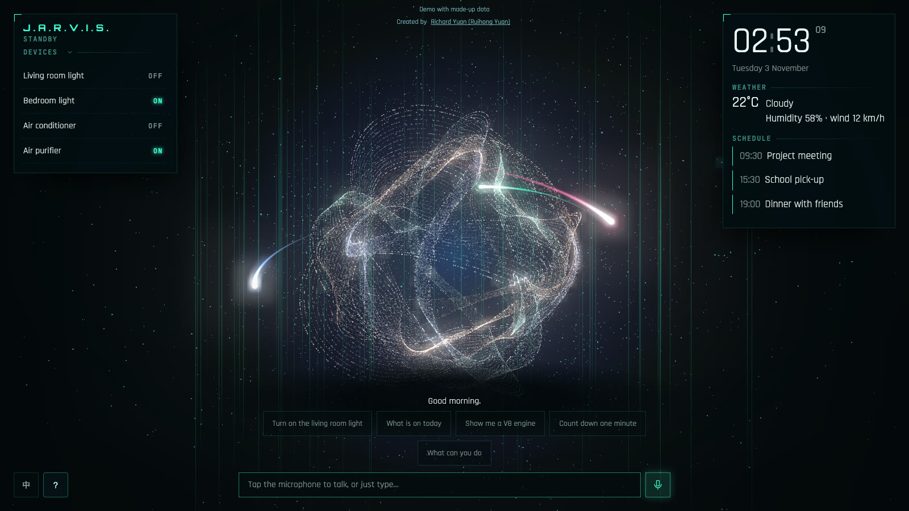
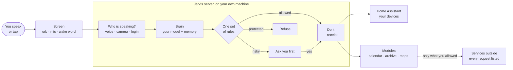
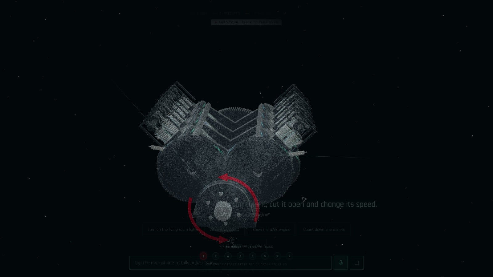
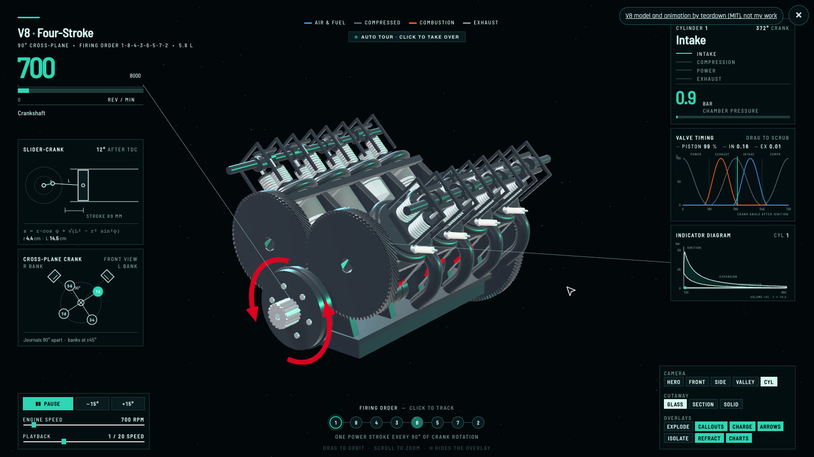

# J.A.R.V.I.S.

English | [中文](README.zh.md)

A household voice butler that lives on your own server. It knows the people it works for, acts for them within the limits they set, and can show you everything it did and why.

By **Richard Yuan (Ruihong Yuan)**.

**[Try the live demo →](https://jarvis-demo.tardisyuan.ltd)**

## What it is

Most home assistants are a voice remote for your devices. Jarvis is built around three other things:

- **It knows your household.** It tells who is speaking by voice. Each person has their own memories and privacy, and a guest can't approve anything.
- **It acts for you, within what you grant.** Standing orders run on their own once you grant them with your PIN, and it speaks up when something needs you.
- **You can check everything.** Every action leaves a receipt, you can ask why it did something or say "undo", and every request that leaves the house is listed.

## What it does

- Talks in Chinese and English, with a "Hey Jarvis" wake word running on the server. Audio is never stored.
- Runs the home through Home Assistant, and asks before anything risky.
- Remembers what you tell it; you can review or delete every memory.
- Calendar, to-dos, timers, routines and a family archive, with no cloud needed. It answers from a folder of documents and says which file and page the answer came from.
- About 50 feature modules, each removable: trains and buses, routes on a 3D map, bin day, a shopping list and more.
- A particle orb that shows what it is doing, and an approval window for what waits on you.

## How it works

## What was hard

- **Knowing who is speaking, on a home server's CPU.** A WeSpeaker voiceprint model checks who is speaking. Only the voiceprints are kept, never the audio, and a person's identity decides what they may do: a guest or a child can't approve anything.
- **One set of rules for everything it may do.** Risky actions wait in one approval window. Each approval is bound by an HMAC to exactly that item and stops working once it is answered, changes or expires, so an old "yes" can't approve something new.
- **Judging models honestly.** Prompts tuned against a test set make that set flatter the model it was tuned for. So candidates are compared on a frozen held-out set that is never tuned against, with answers shuffled and graded blind.

## Engineering

- **Backend:** Python and FastAPI, with a plugin system for feature modules.
- **Models:** local through Ollama, or any OpenAI-compatible server. Speech uses Kokoro, and SenseVoice or a browser's own recognition.
- **Frontend:** plain JavaScript modules and three.js, no framework. The orb is 80,000 particles with auto-adjusting quality.
- **Quality:** about 800 unit tests, 190-odd model evaluations, a frozen held-out set for judging models, and secret scanning on every commit.
- **Runs on:** a Mac, Docker on a home server, or a Raspberry Pi 5.

## About the demo

The [demo](https://jarvis-demo.tardisyuan.ltd) is a static page with no backend and no model: the replies are scripted, the data is made up, and the voice is recorded. It shows the main screen, not the assistant's real abilities. On a computer, tap "Show me a V8 engine": the orb's particles land on the engine's surface, then the solid model comes up over them.

| Particles land on the engine | The engine comes apart | Running |
|---|---|---|
|  |  |  |

<!-- A recording of the real system goes here. -->

## Source

The source code is private for now. Ask me if you would like to see it.

## License

The text and my own images here: [CC BY 4.0](LICENSE). The V8 in the demo images stays under teardown's MIT licence.

## Acknowledgements

- **V8 model and animation in the demo:** the V8 example of [teardown](https://github.com/elvarofficial/teardown) by elvarofficial (MIT), recoloured for a dark page. Not my work.
- **The idea of the orb:** [GDDXX-Jarvis](https://github.com/shitoudaidi/GDDXX-Jarvis) by shitoudaidi (MIT) and the demo videos its author shared. Written from scratch; no code was copied.
- **Built on:** [Home Assistant](https://www.home-assistant.io/), [Ollama](https://ollama.com/), [FastAPI](https://fastapi.tiangolo.com/), [openWakeWord](https://github.com/dscripka/openWakeWord), [WeSpeaker](https://github.com/wenet-e2e/wespeaker), [Kokoro](https://github.com/remsky/Kokoro-FastAPI), [three.js](https://threejs.org/), [sherpa-onnx](https://github.com/k2-fsa/sherpa-onnx) and SenseVoice by [FunAudioLLM / FunASR](https://github.com/modelscope/FunASR), among others.
