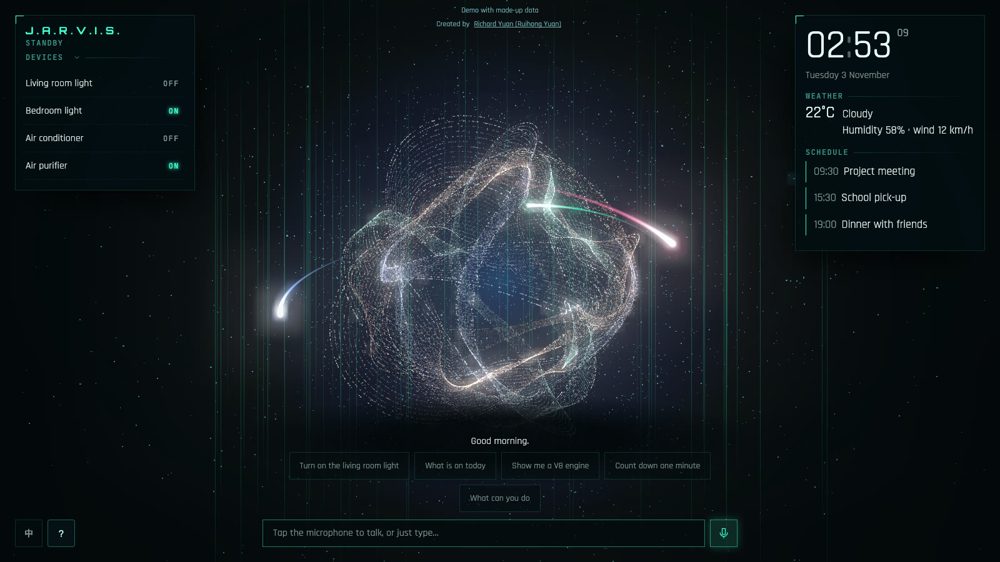
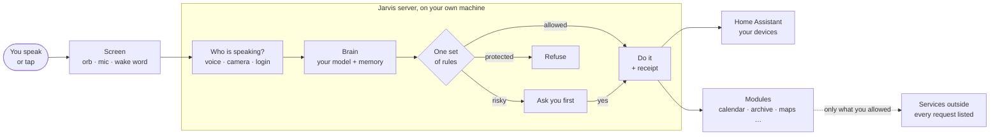
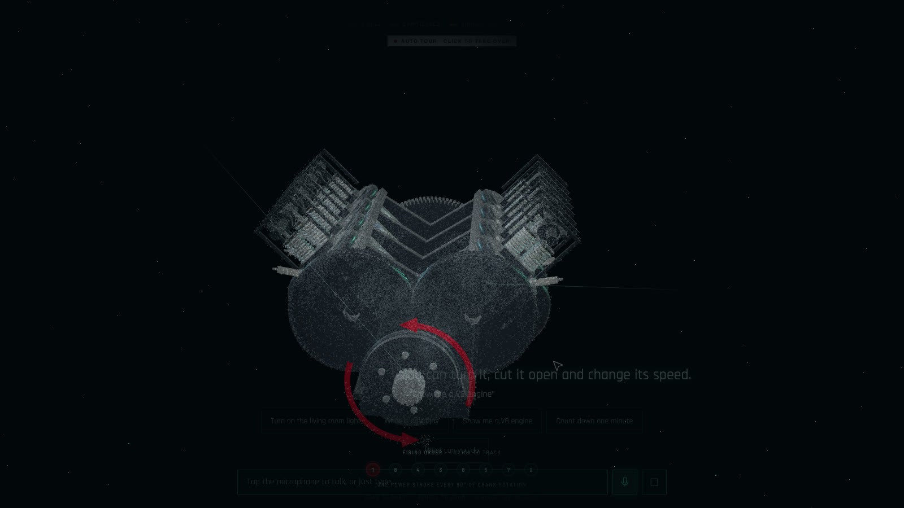
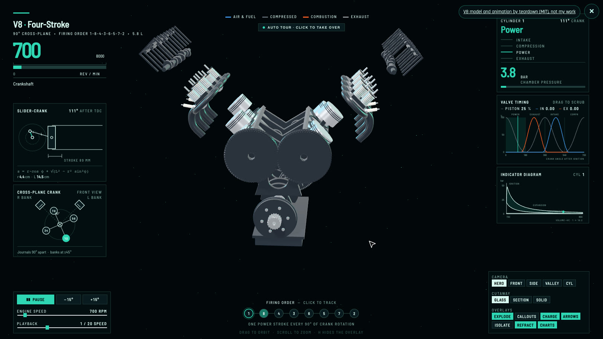
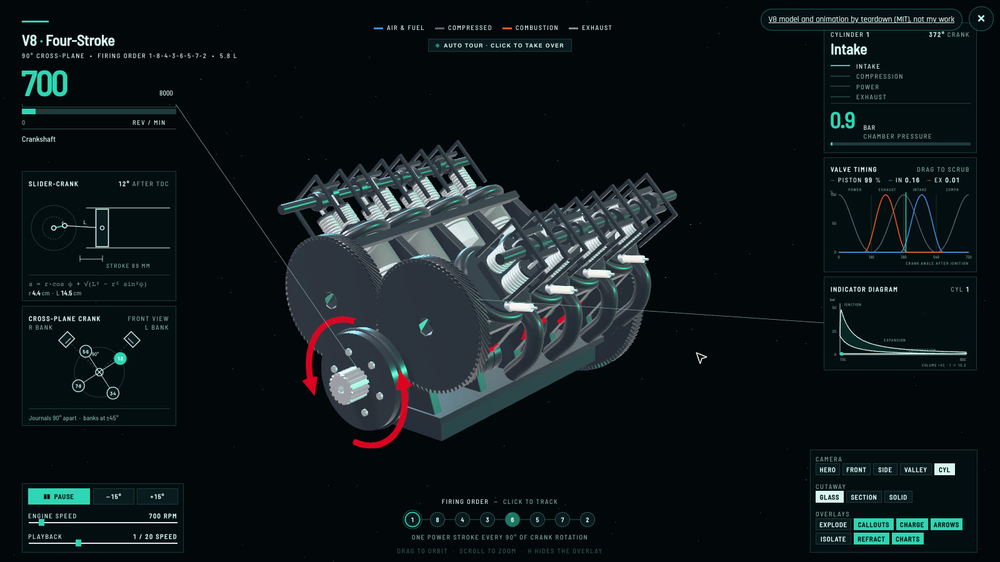

# J.A.R.V.I.S.

[English](README.md) | 中文

住在自家服务器上的语音管家。它认得家里的人，在你允许的范围内替你办事，做过的每件事和原因都能查。

作者：**Richard Yuan (Ruihong Yuan)**

**[打开在线演示 →](https://jarvis-demo.tardisyuan.ltd)**

## 它是什么

多数家庭助手只是设备的语音遥控器。贾维斯围绕另外三件事来做：

- **认得家里的人：** 能听声音分辨是谁在说话。每个人有自己的记忆和隐私，访客不能批准任何操作。
- **在你的授权内办事：** 常用指令经 PIN 授权后可以自动执行，有需要你处理的事情时会主动开口。
- **一切都能查：** 每次操作都留回执，可以问它为什么这样做，也可以说“撤销”。每个发到家外的请求都有记录。

## 它能做什么

- 中英文对话，“Hey Jarvis”唤醒词在服务器上运行，音频不保存。
- 通过 Home Assistant 控制家里的设备，风险操作先问你。
- 记住你说过的话，每条记忆都能查看和删除。
- 日历、待办、定时器、例行任务和家庭档案，不依赖云端。还能从一文件夹的文档里找答案，并说明出自哪个文件哪一页。
- 约 50 个可单独移除的功能模块：火车公交、3D 地图路线、垃圾日、购物清单等。
- 显示当前状态的粒子球，以及等你决定事项的确认窗口。

## 工作方式

## 工程

- **后端：** Python 和 FastAPI，功能模块用插件方式接入。
- **模型：** 通过 Ollama 在本地运行，或接任何兼容 OpenAI 的服务。语音用 Kokoro，识别用 SenseVoice 或浏览器自带能力。
- **前端：** 原生 JavaScript 模块和 three.js，不用框架。粒子球有 8 万颗粒子，画质自动调节。
- **质量：** 约 800 个单元测试、190 多条模型评测，用固定的留出集评估模型，每次提交都做密钥扫描。
- **运行环境：** Mac、家用服务器上的 Docker，或树莓派 5。

## 关于演示

[在线演示](https://jarvis-demo.tardisyuan.ltd)是静态页面，没有后端，也没有接模型：回复是脚本，数据是假的，声音是提前录好的。它展示的是主界面，不代表助手的真实能力。在电脑上点“给我看 V8 发动机”：粒子落到发动机表面，实体模型再从中浮现。

| 粒子落到发动机上 | 发动机拆解 | 运转中 |
|---|---|---|
|  |  |  |

<!-- 真实系统的录屏放这里。 -->

## 源码

源码目前是私有的，想看可以联系我。

## 致谢

- **演示里的 V8 模型和动画：** 来自 elvarofficial 的 [teardown](https://github.com/elvarofficial/teardown) V8 示例（MIT），我改成了适合深色页面的配色。这部分不是我的作品。
- **粒子球的灵感：** shitoudaidi 的 [GDDXX-Jarvis](https://github.com/shitoudaidi/GDDXX-Jarvis)（MIT）和作者分享的演示视频。代码是自己从头写的，没有复制。
- **站在这些项目的肩膀上：** [Home Assistant](https://www.home-assistant.io/)、[Ollama](https://ollama.com/)、[FastAPI](https://fastapi.tiangolo.com/)、[openWakeWord](https://github.com/dscripka/openWakeWord)、[WeSpeaker](https://github.com/wenet-e2e/wespeaker)、[Kokoro](https://github.com/remsky/Kokoro-FastAPI)、[three.js](https://threejs.org/)、[sherpa-onnx](https://github.com/k2-fsa/sherpa-onnx) 和 [FunAudioLLM / FunASR](https://github.com/modelscope/FunASR) 的 SenseVoice 等。
