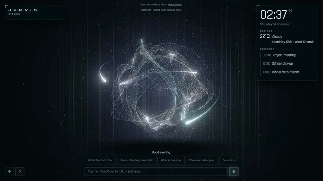
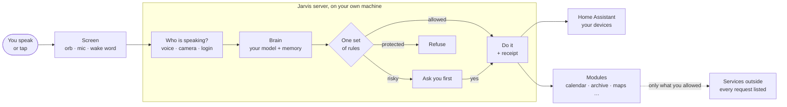
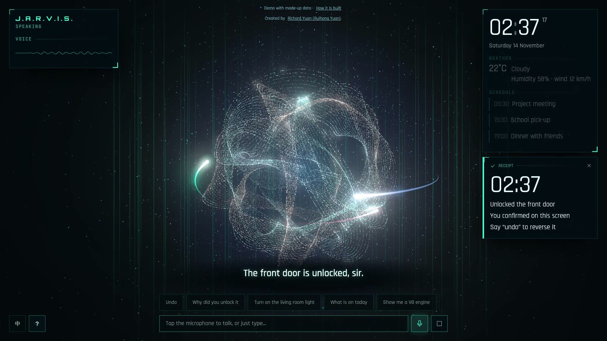
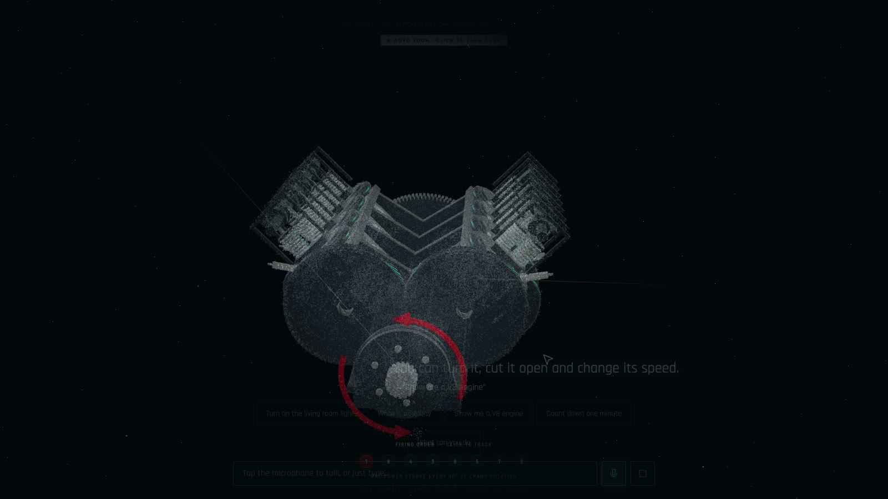
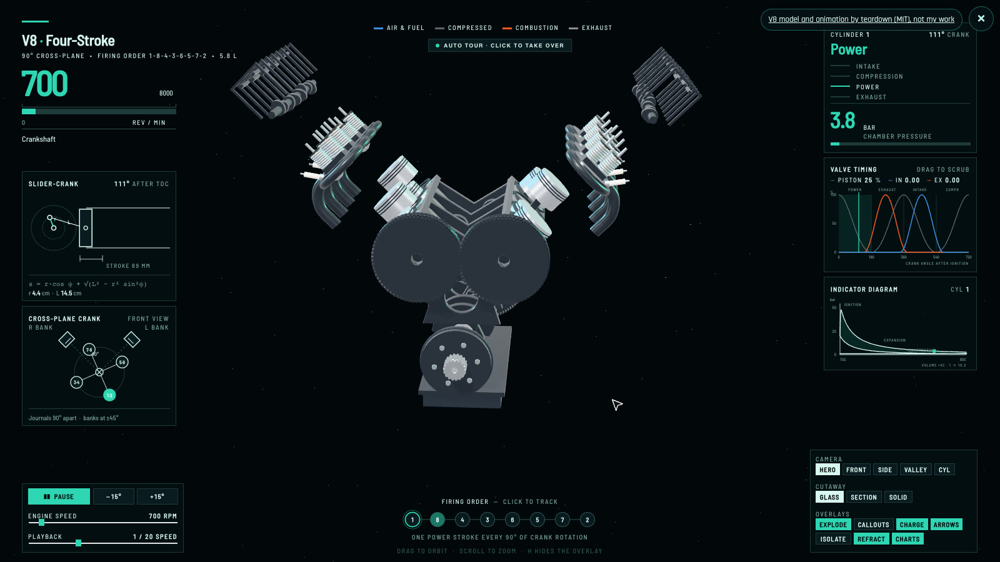
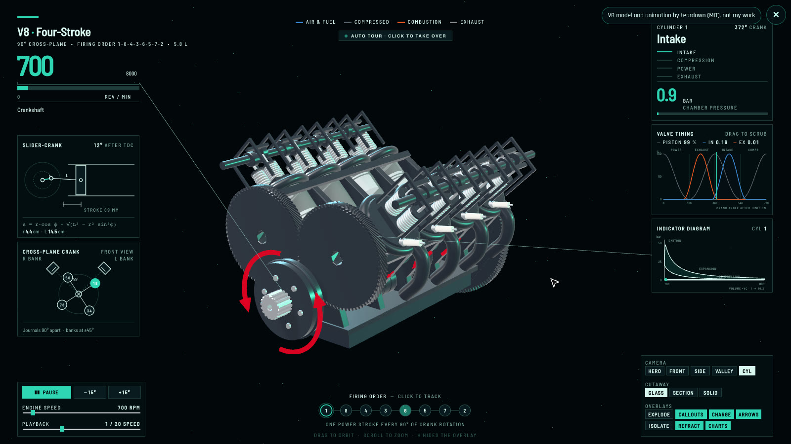

# J.A.R.V.I.S.

[English](README.md) | 中文

住在自家服务器上的语音管家，危险操作由代码把关，不靠模型自觉。它认得家里的人，在你允许的范围内替你办事，做过的每件事和原因都能查。

作者：**Richard Yuan (Ruihong Yuan)**

联系：tardisyuan@gmail.com，或者在这里[开一个 issue](https://github.com/Tardisyuan/jarvis-showcase/issues/new)。

**[打开在线演示 →](https://jarvis-demo.tardisyuan.ltd/?lang=zh)** · [它是怎么做的 →](https://jarvis-demo.tardisyuan.ltd/how) · [看 47 秒的录屏（有声音）](media/jarvis-demo.mp4)

**招人的话：** 先看[难在哪里](#难在哪里)和[怎么做出来的](#怎么做出来的)，再看[设计文档](#设计文档)和[它是怎么做的](https://jarvis-demo.tardisyuan.ltd/how)页。**玩 Home Assistant 或语音助手的话：** 看[给 Home Assistant 和语音玩家](#给-home-assistant-和语音玩家)。

## 它是什么

多数家庭助手只是设备的语音遥控器。贾维斯围绕另外三件事来做：

- **认得家里的人：** 能听声音分辨是谁在说话。每个人有自己的记忆和隐私，访客不能批准任何操作。还有家庭档案，回答时说明日期和出处。
- **在你的授权内办事：** 常用指令经 PIN 授权后可以自动执行，有需要你处理的事情时会主动开口，夜里不打扰。常用指令永远不碰门锁。
- **一切都能查：** 每次操作都留回执，可以问它为什么这样做，也可以说“撤销”。每个发到家外的请求都有记录，而且用的是你自己的模型。

## 难在哪里

- **在家用服务器的 CPU 上分辨是谁在说话：** 用声纹模型（3D-Speaker 的 ERes2Net，经 sherpa-onnx 运行）识别说话的人。只保存声纹，不保存音频；身份决定能做什么，访客和小孩不能批准任何操作。声音可以被录下来重放，所以它只说明是谁在问，从来不是门锁的唯一钥匙。
- **所有操作走同一套规则：** 风险操作都在同一个确认窗口里等待。每次批准都用 HMAC 绑定到具体事项，一旦答复、变更或过期就失效，旧的“同意”不能批准新的事情。
- **外面的话不算命令：** 读过邮件或网页之后，那一轮里的写操作要等你同意，被引用的“打开门”也要等；云端模型看不到这些内容。规则本身（什么能做、什么要先问、外部内容会染上什么）是代码，放在一个只用标准库的小包里，不是提示词里的几句话；每次批准由服务端绑定到具体事项。
- **诚实地评估模型：** 照着测试集调提示词，这套题就会偏向被调过的模型。所以候选模型都用一套从不用来调参的冻结留出集比较，答案打乱后盲评。

## 设计文档

英文：

- [安全模型和威胁模型](docs/safety-model.md)：防的是什么、一次设备写操作怎么判定、哪些防不住。
- [怎么评判模型和改动](docs/evaluation.md)：离线测试、真模型评测、盲评的冻结留出集，以及 AI 代理写的东西怎么把关。
- [架构](docs/architecture.md)：一次请求从头到尾、模块、安全核心、数据、页面，以及取舍。

## 它能做什么

- 中英文对话（回复跟着你说的语言走），“Hey Jarvis”唤醒词在服务器上运行，音频不保存。
- 通过 Home Assistant 控制家里的设备，风险操作先问你。
- 记住你说过的话，每条记忆都能查看和删除。
- 日历、待办、定时器、例行任务和家庭档案，不依赖云端。还能从一文件夹的文档里找答案，并说明出自哪个文件哪一页。
- 按时间提醒，也按人、按地点提醒（“下次我进厨房提醒我关火”）。
- 房间卫星：放在别的房间的树莓派带上麦克风和扬声器，在那里也能认人。
- 55 个可单独移除的功能模块（2026 年 11 月）：火车公交、3D 地图路线、垃圾日、购物清单等。
- 显示当前状态的粒子球，以及等你决定事项的确认窗口。

## 工作方式

## 工程

- **后端：** Python 和 FastAPI，功能模块用插件方式接入。
- **模型：** 通过 Ollama 在本地运行，或接任何兼容 OpenAI 的服务。小模型多给规则兜底，大模型少给（手动设置，不自动切换）；作者自己用的是 gemma4:26b。语音用 Kokoro，识别用服务器上的 SenseVoice 或 Parakeet、兼容 OpenAI 的转写服务，或浏览器自带能力。
- **前端：** 原生 JavaScript 模块和 three.js，不用框架。粒子球有 8 万颗粒子，画质自动调节。
- **质量：** 1113 个离线测试 2026-11-13 全部通过，CI 每天跑（含页面和光球的冒烟测试）；模型评测约 250 项检查；用固定的留出集评估模型；每次提交都做密钥扫描。2026 年 11 月对核心代码做了两轮审查，结论连同查出来不成立的条目都留着（摘要正在整理，之后放到这个仓库）。
- **运行环境：** Mac、家用服务器上的 Docker，或树莓派 5。

## 怎么做出来的

一个人，带着 AI 代理。方向、规矩和审查门槛由我定，大部分代码由 AI 编程代理写（2026 年 10 月下旬到现在约 1600 次提交）。代理说做完了不算数：

- 每次提交都过密钥扫描，每一批都过离线测试；
- CI 每天把全部测试跑一遍，页面和光球在无头浏览器里跑；
- 改了模型看到的内容，就用真模型评测来判；换候选模型，用冻结的留出集盲评；
- 每一批都要几个独立的评审代理从多个角度打分，过了才往下做；评审结论都留着，连后来证明错了的也留着。

这体现的正是我想提供的能力：把一个模糊的目标，变成 AI 能被约束住的规则、测试和评审。

## 给 Home Assistant 和语音玩家

- 贾维斯通过 Home Assistant（2025.2 或更新）的 **Model Context Protocol Server** 集成连接，只看得到你暴露给 Assist 的设备。门锁、窗帘、警报、阀门、插座和 HA 脚本的操作一律先等你同意。
- 大脑是你自己的模型，经 Ollama 或任何兼容 OpenAI 的服务；作者用的是 24 GB 显卡上的 gemma4:26b，小模型会多给一些规则兜底。
- 唤醒词、声纹和（可选的）语音识别都在服务器 CPU 上跑；没有屏幕的房间用树莓派卫星。
- 源码是私有的，暂时不能安装。想法随便拿去用；想看后续，可以关注（Watch）这个仓库。

## 关于演示

[在线演示](https://jarvis-demo.tardisyuan.ltd/?lang=zh)是静态页面，没有后端，也没有接模型：回复是脚本，数据是假的，声音是提前录好的。它展示的是主界面，不代表助手的真实能力。[它是怎么做的](https://jarvis-demo.tardisyuan.ltd/how)页讲了架构、数字和设计取舍。点“打开前门”可以体验真实的确认窗口、回执和撤销（数据是假的）。在电脑上点“给我看 V8 发动机”：粒子落到发动机表面，实体模型再从中浮现。

| 粒子落到发动机上 | 发动机拆解 | 运转中 |
|---|---|---|
|  |  |  |

<!-- 真实系统的录屏放这里。 -->

## 源码

源码是私有的：贾维斯跑在一个真实的家里。从这里能核对的有：[在线演示](https://jarvis-demo.tardisyuan.ltd/?lang=zh)和[它是怎么做的](https://jarvis-demo.tardisyuan.ltd/how)页，那里的每个数字都写着出自哪个文件。

有问题，或者想聊工作机会：tardisyuan@gmail.com，或者[开一个 issue](https://github.com/Tardisyuan/jarvis-showcase/issues/new)。

## 许可

这里的文字和我自己的图片采用 [CC BY 4.0](LICENSE)。演示截图里的 V8 仍遵循 teardown 的 MIT 许可。

## 致谢

- **演示里的 V8 模型和动画：** 来自 elvarofficial 的 [teardown](https://github.com/elvarofficial/teardown) V8 示例（MIT），我改成了适合深色页面的配色。这部分不是我的作品。
- **粒子球的灵感：** shitoudaidi 的 [GDDXX-Jarvis](https://github.com/shitoudaidi/GDDXX-Jarvis)（MIT）和作者分享的演示视频。代码是自己从头写的，没有复制。
- **站在这些项目的肩膀上：** [Home Assistant](https://www.home-assistant.io/)、[Ollama](https://ollama.com/)、[FastAPI](https://fastapi.tiangolo.com/)、[openWakeWord](https://github.com/dscripka/openWakeWord)、[3D-Speaker](https://github.com/modelscope/3D-Speaker)、[Kokoro](https://github.com/remsky/Kokoro-FastAPI)、[three.js](https://threejs.org/)、[sherpa-onnx](https://github.com/k2-fsa/sherpa-onnx) 和 [FunAudioLLM / FunASR](https://github.com/modelscope/FunASR) 的 SenseVoice 等。
