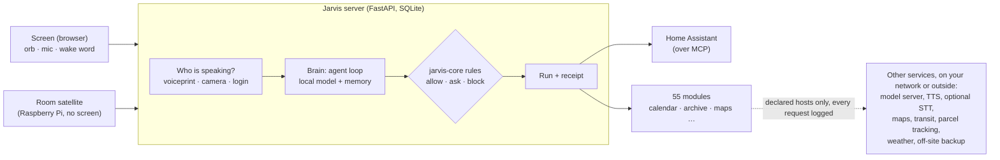

# Jarvis's architecture: one request end to end, and why it is built this way

**In short**

- A screen or a room satellite hears the request; the server works out who is speaking, the brain (your own model) proposes, and one set of rules in a stdlib-only package decides.
- 55 feature modules reach the core only through one small API, declare what they read, write and connect to, and are checked by contract tests.
- No framework and no build step on the page; one SQLite file with ordered migrations on the server.

Jarvis is a voice butler for one household, on the household's own machines. It knows who is speaking, acts within limits the owner sets, and leaves a receipt for everything it does. This note follows one spoken request through it. The source is private; paths below are places in it.

The idea behind most of the choices is simple. The language model is the part most likely to be wrong, or to be talked into something by text it reads. So the model proposes and plain code decides.

## The parts: a screen, a server, and one gate in the middle



The page talks only to the Jarvis server. The Home Assistant token, the model endpoints and every module's API keys stay on the server; the page never receives them (`server/app.py`). Home Assistant is reached through its Model Context Protocol server, so Jarvis sees only the entities the owner exposes to Assist.

## One request end to end

**1. Wake word.** The screen streams 16 kHz microphone frames over a WebSocket (`/api/wake`) to the server. openWakeWord scores them in memory there (`server/wake.py`), and no audio is written to disk or the log. With several screens open, only the focused one listens. A room satellite runs `wyoming-satellite` and hears the wake word on the device itself; Jarvis connects to it and receives the request audio (`server/modules/satellites`).

**2. Speech to text.** After the wake word, the server collects one utterance. It keeps about a second from before the wake moment, ends after 0.8 s of quiet, and never listens longer than 25 s (`server/stt.py`). The words come from one of three places: the browser's own recognizer, an OpenAI-compatible transcription server, or local models on the server through sherpa-onnx (SenseVoice, with Parakeet for English). Filler and recognition junk are dropped, and homophones of the home's device words corrected (`server/heard.py`).

**3. Who is speaking.** While the request is heard, a voiceprint is taken from the last 1.5 s of frames and matched against the household's enrolled voices: 3D-Speaker's ERes2Net through sherpa-onnx, cosine similarity, threshold 0.65 (`server/voiceid.py`; set on one household's voices and microphones, with no measured false-accept rate yet). Only the 256-number vectors are kept, never the audio. `trust.who` fuses voice, a face seen in the room, and the screen's login into one person and a role: owner, family, child, or guest. If voice and face disagree, the asker is a guest. A voiceprint is not treated as a lock, because a voice can be replayed. It decides whose "yes" counts. For locks and alarms, only the owner's yes counts, and otherwise the PIN.

**4. The agent loop.** `Brain.ask` (`server/brain.py`) runs the request under a per-session lock, so a "yes" can only answer the question that session was asked. Cheap paths come first: a module's rule answer (timers, the time), or an exact match of Home Assistant's sentence templates, which still goes through the tool gate. Otherwise the loop recalls memories, picks the tools this person may use, and calls the model: at most six rounds in a 60-second budget. Tool arguments are checked against their JSON schema before anything runs. A failed call is never retried, and three failures stop the request with an honest reply. Outside text (an email, an invite, a web page) is wrapped as data, logged only by size, and taints the session.

**5. The policy check.** Every tool call goes through one function, `run_tool` (`server/brain_tools.py`), and every write path asks one policy function in the safety core (`core/src/jarvis_core/policy.py`, lines 276–286):

```python
def policy(cfg, ha, externals, name, args, skip_confirm=False):
    """The one place that decides whether a proposed write may run: 'block' > 'confirm' > 'allow'. Every write path
    (voice/text tools, the device panel, the keyword fallback) goes through it. skip_confirm (the user said yes)
    only turns 'confirm' into 'allow'; a block stays a block."""
    if (ext := external(externals, name)) and not is_read(*ext) and not skip_confirm:
        return 'confirm'   # another server's write (sending an email…): always asked, whatever the settings say
    if blocked(cfg, ha, name, args):
        return 'block'
    if (name.split('__')[-1] in (cfg.get('confirm') or []) or risky(ha, name, args)) and not skip_confirm:
        return 'confirm'
    return 'allow'
```

Writes to locks, covers, alarms, valves, switches (plugs) and HA scripts always ask first. When a write needs a yes, the loop stops and the harness phrases the question from a template, not the model. A pending yes lasts 90 seconds and covers at most five actions (`jarvis_core/confirm.py`). In a tainted turn (outside content read, or a quoted command), every write waits for a yes.

**6. The reply.** A reply that claims an action without a tool call is nudged once; on the small-model setting, one that stays wrong is replaced. Only a request sent to a local model with no tools at all (plain talk, a knowledge question) streams, sentence by sentence, as NDJSON on `/api/chat` (`server/streaming.py`). Anything that looks like an action is not streamed, so nothing is spoken before the gate decides.

**7. Text to speech.** The page sends each sentence to `/api/tts`; satellites get WAV through the same `server/tts.py`. A TTS server outside the home is refused personal text by the same egress gate as everything else.

**8. The receipt.** `run_tool` writes a receipt for every call: tool, arguments, whether it was a write, the policy's decision, the result, time taken, who asked, and who approved it. "Why did you turn off the light?" and "what did you do today?" are answered from these rows, not from the model's recollection. A receipt that fails to write is logged and never undoes the action.

**Timings.** The `traces` module records each request's duration and model rounds. There is no reliable measure yet of end-to-end latency, from your last word to Jarvis's first. The numbers above are configured limits, not measured speeds.

## Modules: 55 features, all but two removable, all through one door

Every feature is one of 55 modules in `server/modules/<name>/`, Home Assistant itself included. The owner can turn any of them off except two: `safety` (the help call) and `ha`. The core keeps only the brain loop, policy and confirmation, auth, the database, config, the voice pipeline and memory, plus generic hooks.

A module **may** offer tools (split into `reads` and `writes`), add routes under its own prefix, answer by rule before the model, add context, keep sealed tables, and own its settings and secrets. It **may not** import the server's internals, reach the brain object, name a core table in its SQL, or decide confirmation (a `confirmed: true` argument is ignored). Modules reach the core only through `server/modules/kit.py`, a documented API that only grows within one API version. A contract test parses every module's imports with `ast` and fails on any other; more contract tests check that tools are exactly reads plus writes, outside results taint the turn, and personal tools never reach a cloud model. A module that fails at start-up goes inactive (its routes answer 503); the app still boots.

Every module ships a `module.toml` that says what its code does. This is the maps module's (`server/modules/maps/module.toml`, lines 13–22):

```toml
[permissions]
network = ["api.mapbox.com"]
tools = ["show_route"]
reads_home = true
writes_home = false
page = true    # page/: its cards on the settings page (settings.js) and its part of the main screen (index.js), if any

[[permissions.secrets]]
name = "token"
host = "api.mapbox.com"
```

The network list is enforced: each module's own HTTP client checks every request against it before sending, pins the connection to a checked address, and follows no redirects (`server/netguard.py`).

## The safety core is a separate package with no dependencies

The rules live in `core/` as `jarvis-core`. It has about 2,100 lines across ten files, and its `pyproject.toml` says `dependencies = []`, with a comment: no web framework, no model client, no Home Assistant. It holds the policy, confirmations, which words count as yes, taint and egress, argument checks, who is asking, receipts and the egress ledger, unprompted notices, and the module contract.

Why: the rules can be read and tested without the server; no framework or SDK upgrade can quietly change them; and review has a clear boundary, since a change to `core/` is a change to what Jarvis may do.

## Data: one SQLite file, ordered migrations, sealed rows

All state is in one SQLite database (WAL). The schema changes only through `server/db_migrations.py`, an ordered list of steps `_v1` to `_v25`, counted by `PRAGMA user_version`; released steps are never edited. Before an upgrade, the file is backed up with SQLite's backup API, and each step runs in its own transaction. A database from a newer version is refused before anything is touched.

Memory stores facts a person asked Jarvis to keep (`server/memory.py`). Recall merges cosine similarity over local embeddings with exact-word matches, by reciprocal rank fusion. The embeddings come from a local model; in the author's setup it is served on the home network. The scan is linear, and a comment notes this is fine up to about 10,000 memories, past which it should move to SQLite FTS5.

Private columns are sealed with AES-256-GCM (`server/crypto.py`, `server/vault.py`). The core seals memory text and embeddings, conversation turns, log messages and data, receipt arguments and the words asked, revision history, and voiceprint vectors. Modules add their own tables, such as the archive and mail. Each blob is bound to its table and column, so a value copied elsewhere won't open. The household's keys open at boot from a key file, so the house runs unattended. An adult may have a vault of their own behind a passphrase, locked after 30 idle minutes; a child's opens with a PIN for 10 minutes. A locked vault is neither read nor written, never quietly written under another key.

## The page: no framework, no build step

The screens are plain ES modules served as files (`page/`). There is no bundler and no framework. Third-party code (three.js 0.186.1, fonts, a QR library) is vendored with pinned hashes, so a screen without internet looks and works the same.

State reaches the page over Server-Sent Events (`/api/events`): device updates, log lines, focus, announcements. Wake-word audio goes up a WebSocket; requests are a `POST /api/chat`.

The orb is a three.js particle system of 8 ribbons × 10,000 particles, 80,000 in all (`page/orb/silk.js`). Quality tiers (`page/orb/loop.js`) low, standard and high change pixel ratio, bloom resolution and idle frame rate, never the particles; "auto" times a few seconds of frames and steps down if they stay slow. A fourth, lavish, adds costly effects (frosted panels, an icosahedron in the orb) and is manual only.

## Trade-offs, what was cut, and what runs where

- **Rules that lean in or step aside.** `brain.capability` is a setting. On "weak" (the default, for a ~9B model; the author runs "strong" since 2026-11-12) common requests go by rule and tools are offered only when the words ask; on "strong" every allowed tool is offered. It never switches by itself, and the safety rules are the same on both.
- **Narrow streaming.** Actions feel slower, but nothing is spoken before the policy decides.
- **Shelved:** autonomous agents that write and run their own code, an automatically pulled skill marketplace, a Chinese wake word, music, anything to do with money, and gestures. Moving the server onto the home server is also shelved for now.

**What runs where.** The author's live instance of the Jarvis server runs on a Mac. A home server runs Home Assistant in a VM and the model server: the brain is a 26B model on a 24 GB GPU, and text to speech runs there too. A second GPU serves the embeddings. A Raspberry Pi 5 is the room-satellite trial and the performance rig for the page. The same server also runs from `compose.yaml` in Docker, on a home server or a Raspberry Pi 5.

---

*Part of the [Jarvis showcase](../README.md) · [live demo](https://jarvis-demo.tardisyuan.ltd/?lang=en) · [how it is built](https://jarvis-demo.tardisyuan.ltd/how). Other notes: [safety model](safety-model.md) · [how models are judged](evaluation.md). Written November 2026; questions: [open an issue](https://github.com/Tardisyuan/jarvis-showcase/issues/new/choose).*

<!-- sources: README.md; docs/guide.md (Privacy, Modules); server/app.py; server/brain.py (ask, whole_request, _ask, _loop, _final_reply, _run_calls, _after_calls, should_stream); server/brain_tools.py (run_tool, _run_tool, run_external); server/config.py (REQUEST_BUDGET_S); server/api_chat.py; server/api_page.py (/api/events); server/api_voice.py (/api/wake); server/wake.py; server/stt.py; server/heard.py; server/voiceid.py; server/tts.py; server/streaming.py; server/memory.py; server/crypto.py; server/vault.py; server/db.py (_migrate, CORE_SEALED); server/db_migrations.py; server/netguard.py; server/state.py (NEVER_OFF); server/modules/README.md; server/modules/kit.py; server/modules/maps/module.toml; server/modules/satellites/README.md; tests/modules/test_contract.py; tests/modules/test_contract_boot.py; core/README.md; core/pyproject.toml; core/src/jarvis_core/{policy,confirm,trust}.py; page/package.json; page/vendor/VERSIONS.md; page/orb/silk.js; page/orb/loop.js; page/main/{panels,voice,speech}.js; tools/demo/how.html; docs/roadmap.md (E, Shelved); docs/handoff.md §一, §二, §六 -->
