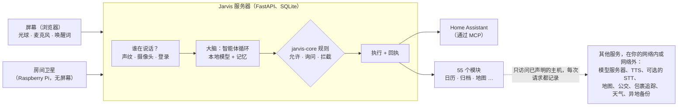

# Jarvis 的架构：一个请求从头到尾，以及为什么这样搭

[English](architecture.md) | 中文

**简而言之**

- 屏幕或房间卫星听到请求；服务器判断是谁在说话，大脑（你自己的模型）提出方案，由一个只用标准库的包里的一套规则来决定。
- 55 个功能模块只通过一个小小的 API 接入核心，声明各自要读什么、写什么、连哪里，并由契约测试检查。
- 页面没有框架，也没有构建步骤；服务器端是一个 SQLite 文件，迁移按顺序执行。

Jarvis 是一个语音管家，服务一个家庭，运行在这个家庭自己的机器上。它知道是谁在说话，在主人设定的范围内行动，做的每件事都留下回执。本文跟着一句语音请求走一遍。源码不公开；下文的路径指的是源码里的位置。

多数设计背后的想法很简单。语言模型最容易出错，也最容易被它读到的文字说动。所以由模型提出方案，由普通代码来决定。

## 各个部分：一块屏幕、一台服务器，中间一道关卡



页面只和 Jarvis 服务器通信。Home Assistant 的令牌、模型端点和每个模块的 API 密钥都留在服务器上，页面拿不到（`server/app.py`）。Home Assistant 通过它的 Model Context Protocol 服务器接入，所以 Jarvis 只能看到主人开放给 Assist 的实体。

## 一个请求，从头到尾

**1. 唤醒词。** 屏幕通过 WebSocket（`/api/wake`）把 16 kHz 的麦克风帧推给服务器。openWakeWord 在服务器内存里给这些帧打分（`server/wake.py`），音频不会写入磁盘或日志。开着多块屏幕时，只有处于焦点的那块在听。房间卫星运行 `wyoming-satellite`，在设备本机识别唤醒词；Jarvis 连上它并接收请求音频（`server/modules/satellites`）。

**2. 语音转文字。** 唤醒之后，服务器收集一句话。它保留唤醒时刻之前约一秒的音频，安静 0.8 秒后结束，最长不超过 25 秒（`server/stt.py`）。文字来自三个来源之一：浏览器自带的识别器、兼容 OpenAI 的转写服务器，或服务器上通过 sherpa-onnx 运行的本地模型（SenseVoice，英文用 Parakeet）。语气词和识别杂音会被丢掉，与家里设备名读音相近的词会被纠正（`server/heard.py`）。

**3. 是谁在说话。** 听请求的同时，取最后 1.5 秒的帧生成声纹，与家里已登记的声音比对：用 3D-Speaker 的 ERes2Net，经 sherpa-onnx 运行，余弦相似度，阈值 0.65（`server/voiceid.py`；按一户人家的声音和麦克风定的，误认率还没有测）。只保存 256 维的向量，从不保存音频。`trust.who` 把声音、房间里看到的人脸和屏幕的登录合成一个人和一个角色：主人、家人、孩子或访客。声音和人脸对不上时，提问者按访客处理。声纹不当作锁，因为声音可以被重放。它只决定谁说的「好」算数。对于门锁和警报，只有主人说的「好」算数，否则要输入 PIN。

**4. 智能体循环。** `Brain.ask`（`server/brain.py`）在每个会话各自的锁下运行请求，所以一句「好」只能回答该会话被问到的那个问题。便宜的路径优先：模块的规则回答（计时器、报时），或与 Home Assistant 句式模板完全匹配，这类请求仍然要过工具关卡。否则，循环会召回记忆、选出这个人可以用的工具，然后调用模型：最多六轮，预算 60 秒。工具参数在执行前先按 JSON schema 检查。失败的调用从不重试，失败三次就以诚实的回复结束请求。外部文字（邮件、邀请、网页）会被当作数据包起来，日志里只记大小，并且会污染该会话。

**5. 策略检查。** 每次工具调用都经过一个函数 `run_tool`（`server/brain_tools.py`），每条写入路径都要问安全核心里的同一个策略函数（`core/src/jarvis_core/policy.py`，第 276–286 行）：

```python
def policy(cfg, ha, externals, name, args, skip_confirm=False):
    """The one place that decides whether a proposed write may run: 'block' > 'confirm' > 'allow'. Every write path
    (voice/text tools, the device panel, the keyword fallback) goes through it. skip_confirm (the user said yes)
    only turns 'confirm' into 'allow'; a block stays a block."""
    if (ext := external(externals, name)) and not is_read(*ext) and not skip_confirm:
        return 'confirm'   # another server's write (sending an email…): always asked, whatever the settings say
    if blocked(cfg, ha, name, args):
        return 'block'
    if (name.split('__')[-1] in (cfg.get('confirm') or []) or risky(ha, name, args)) and not skip_confirm:
        return 'confirm'
    return 'allow'
```

对门锁、卷帘、警报、阀门、开关（插座）和 HA 脚本的写入，一律先询问。写入需要一句「好」时，循环会停下，由框架用模板来措辞问题，而不是模型。待确认的「好」有效 90 秒，最多覆盖五个动作（`jarvis_core/confirm.py`）。在被污染的轮次里（读过外部内容，或引用了一条命令），每次写入都要等一句「好」。

**6. 回复。** 回复声称做了某个动作却没有调用工具，会被提醒一次；在小模型设置下，仍然不对的回复会被替换。只有发给本地模型、且完全不带工具的请求（闲聊、知识问答）才流式输出，按句子逐句以 NDJSON 形式走 `/api/chat`（`server/streaming.py`）。任何看起来像动作的请求都不流式输出，所以在关卡做出决定之前不会说出任何话。

**7. 文字转语音。** 页面把每个句子发给 `/api/tts`；卫星通过同一个 `server/tts.py` 拿到 WAV。家庭之外的 TTS 服务器，和其他一切一样，由同一道出口关卡拒绝接收个人文字。

**8. 回执。** `run_tool` 为每次调用写一份回执：工具、参数、是否为写入、策略的决定、结果、耗时、谁提的请求、谁批准的。「你为什么关了灯？」和「你今天做了什么？」都从这些记录里回答，而不是靠模型的回忆。回执写入失败只会记入日志，绝不会撤销已经做的动作。

**耗时。** `traces` 模块记录每个请求的耗时和模型轮数。目前还没有可靠的端到端延迟度量，也就是从你说完最后一个字到 Jarvis 开口的时间。上面的数字是配置的上限，不是实测速度。

## 模块：55 个功能，除两个外都可移除，都走同一道门

每个功能都是 `server/modules/<name>/` 里 55 个模块中的一个，Home Assistant 本身也在内。主人可以关掉其中任何一个，只有两个例外：`safety`（求助呼叫）和 `ha`。核心只保留大脑循环、策略与确认、认证、数据库、配置、语音管线和记忆，外加一些通用钩子。

模块**可以**提供工具（分为 `reads` 和 `writes`）、在自己的前缀下添加路由、在模型之前按规则作答、添加上下文、持有加密的表，以及拥有自己的设置和密钥。模块**不可以**导入服务器内部、接触大脑对象、在 SQL 里写核心表的名字，或决定确认（`confirmed: true` 参数会被忽略）。模块只通过 `server/modules/kit.py` 接入核心；这是一份有文档的 API，在同一个 API 版本内只增不减。一个契约测试用 `ast` 解析每个模块的导入，遇到其他导入就失败；另有契约测试检查：工具恰好等于 reads 加 writes、外部结果会污染该轮、个人工具绝不会到达云端模型。启动时失败的模块会变为停用（它的路由返回 503）；应用仍能启动。

每个模块都带一个 `module.toml`，说明它的代码做什么。下面是地图模块的（`server/modules/maps/module.toml`，第 13–22 行）：

```toml
[permissions]
network = ["api.mapbox.com"]
tools = ["show_route"]
reads_home = true
writes_home = false
page = true    # page/: its cards on the settings page (settings.js) and its part of the main screen (index.js), if any

[[permissions.secrets]]
name = "token"
host = "api.mapbox.com"
```

网络名单是强制执行的：每个模块自己的 HTTP 客户端在发送前，会把每个请求对照名单检查，把连接固定到已检查过的地址，并且不跟随重定向（`server/netguard.py`）。

## 安全核心是一个独立的包，没有任何依赖

规则放在 `core/` 里，叫 `jarvis-core`。它大约 2,100 行，分在十个文件里，它的 `pyproject.toml` 写着 `dependencies = []`，并附一句注释：没有 Web 框架，没有模型客户端，没有 Home Assistant。它包含策略、确认、哪些词算「好」、污染与出口、参数检查、谁在提问、回执与出口账本、主动通知，以及模块契约。

为什么这样做：规则脱离服务器也能阅读和测试；框架或 SDK 升级不会悄悄改掉它们；审查也有清晰的边界，因为改动 `core/` 就是改动 Jarvis 可以做什么。

## 数据：一个 SQLite 文件，按顺序的迁移，加密的行

所有状态都在一个 SQLite 数据库里（WAL）。表结构只通过 `server/db_migrations.py` 变更，那是一个有序的步骤列表，从 `_v1` 到 `_v25`，由 `PRAGMA user_version` 计数；已发布的步骤从不修改。升级之前，先用 SQLite 的备份 API 备份文件，每个步骤在各自的事务里运行。来自更新版本的数据库，在碰它之前就会被拒绝。

记忆保存人让 Jarvis 记住的事实（`server/memory.py`）。召回时把本地嵌入上的余弦相似度与精确词匹配，用倒数排名融合（reciprocal rank fusion）合并。嵌入来自本地模型；在作者的环境里，它部署在家庭网络上。扫描是线性的，代码里有一条注释说明，到大约 10,000 条记忆之前都没问题，超过之后应改用 SQLite FTS5。

私密的列用 AES-256-GCM 加密（`server/crypto.py`、`server/vault.py`）。核心加密的内容有：记忆文本和嵌入、对话轮次、日志消息和数据、回执参数和所问的话、修订历史，以及声纹向量。模块会加自己的表，比如归档和邮件。每个数据块都绑定到它所在的表和列，所以复制到别处的值打不开。家庭的密钥在启动时从密钥文件打开，所以这个家可以无人值守地运行。成年人可以有一个自己的保险库，用口令保护，闲置 30 分钟后锁上；孩子的保险库用 PIN 打开，开 10 分钟。锁住的保险库既不读也不写，绝不会悄悄用另一把密钥写入。

## 页面：没有框架，没有构建步骤

界面是普通的 ES 模块，以文件形式提供（`page/`）。没有打包器，也没有框架。第三方代码（three.js 0.186.1、字体、二维码库）连同固定的哈希一起放进仓库，所以没有互联网的屏幕看起来和用起来都一样。

状态通过 Server-Sent Events（`/api/events`）到达页面：设备更新、日志行、焦点、播报。唤醒词音频走 WebSocket 上行；请求是一次 `POST /api/chat`。

光球是一个 three.js 粒子系统，8 条丝带 × 每条 10,000 个粒子，共 80,000 个（`page/orb/silk.js`）。质量档位（`page/orb/loop.js`）low、standard 和 high 改变像素比、泛光分辨率和空闲帧率，从不改变粒子数；「auto」会计时几秒的帧，如果一直很慢就降一档。第四档 lavish 加入开销较大的效果（磨砂面板、光球里的二十面体），只能手动开启。

## 取舍、砍掉了什么，以及什么跑在哪里

- **规则可以靠前，也可以让开。** `brain.capability` 是一个设置。选「weak」（默认，面向约 9B 的模型；作者自 2026-11-12 起用「strong」）时，常见请求按规则处理，只有话里要求时才提供工具；选「strong」时，提供所有被允许的工具。它从不自动切换，两档的安全规则完全相同。
- **流式输出很窄。** 动作会觉得慢一些，但在策略做出决定之前不会说出任何话。
- **已搁置：** 自己写代码并运行的自主智能体、自动拉取的技能市场、中文唤醒词、音乐、一切与钱有关的功能，以及手势。把服务器搬到家用服务器上，目前也搁置了。

**什么跑在哪里。** 作者正在使用的 Jarvis 服务器实例跑在一台 Mac 上。一台家用服务器在虚拟机里运行 Home Assistant，并运行模型服务器：大脑是 24 GB 显卡上的 26B 模型，文字转语音也在那里运行。第二块 GPU 提供嵌入。一台 Raspberry Pi 5 是房间卫星的试验机，也是页面的性能测试台。同一个服务器也可以用 `compose.yaml` 在 Docker 里运行，放在家用服务器或 Raspberry Pi 5 上。

---

*属于 [Jarvis 展示](../README.zh.md) · [在线演示](https://jarvis-demo.tardisyuan.ltd/?lang=zh) · [它是怎么搭的](https://jarvis-demo.tardisyuan.ltd/how)。其他文章：[安全模型](safety-model.zh.md) · [如何评判模型](evaluation.zh.md)。写于 2026 年 11 月；有问题：[提交 issue](https://github.com/Tardisyuan/jarvis-showcase/issues/new/choose)。*

<!-- sources: README.md; docs/guide.md (Privacy, Modules); server/app.py; server/brain.py (ask, whole_request, _ask, _loop, _final_reply, _run_calls, _after_calls, should_stream); server/brain_tools.py (run_tool, _run_tool, run_external); server/config.py (REQUEST_BUDGET_S); server/api_chat.py; server/api_page.py (/api/events); server/api_voice.py (/api/wake); server/wake.py; server/stt.py; server/heard.py; server/voiceid.py; server/tts.py; server/streaming.py; server/memory.py; server/crypto.py; server/vault.py; server/db.py (_migrate, CORE_SEALED); server/db_migrations.py; server/netguard.py; server/state.py (NEVER_OFF); server/modules/README.md; server/modules/kit.py; server/modules/maps/module.toml; server/modules/satellites/README.md; tests/modules/test_contract.py; tests/modules/test_contract_boot.py; core/README.md; core/pyproject.toml; core/src/jarvis_core/{policy,confirm,trust}.py; page/package.json; page/vendor/VERSIONS.md; page/orb/silk.js; page/orb/loop.js; page/main/{panels,voice,speech}.js; tools/demo/how.html; docs/roadmap.md (E, Shelved); docs/handoff.md §一, §二, §六 -->
